# DABstar

[English](README.md) | **Deutsch**

*Dies ist die deutsche Übersetzung der [englischen README](README.md). Im Zweifelsfall ist die englische Fassung maßgeblich.
Die Bezeichnungen der Bedienelemente sind wie in der (englischsprachigen) Oberfläche angegeben.*

## Inhaltsverzeichnis
<!-- TOC -->
* [Inhaltsverzeichnis](#inhaltsverzeichnis)
* [Bilder von DABstar](#bilder-von-dabstar)
    * [Hauptfenster](#hauptfenster)
        * [Schaltflächen im Hauptfenster](#schaltflächen-im-hauptfenster)
        * [Ampelanzeigen im Hauptfenster](#ampelanzeigen-im-hauptfenster)
        * [SNR- und MER-Balkenanzeige im Hauptfenster](#snr--und-mer-balkenanzeige-im-hauptfenster)
        * [Dateiplayer im Hauptfenster](#dateiplayer-im-hauptfenster)
    * [Fenster Ensemble-Liste (Gerätemodus)](#fenster-ensemble-liste-gerätemodus)
    * [Fenster Ensemble-Liste (Dateimodus)](#fenster-ensemble-liste-dateimodus)
    * [Konfigurationsfenster](#konfigurationsfenster)
    * [Fenster Scope, Spektrum, Korrelation, Statistik](#fenster-scope-spektrum-korrelation-statistik)
    * [Fenster FIB-Inhalt](#fenster-fib-inhalt)
    * [Journaline-Fenster](#journaline-fenster)
    * [EPG-Fenster](#epg-fenster)
    * [TII-Liste mit Details der empfangenen Sender](#tii-liste-mit-details-der-empfangenen-sender)
    * [Kartenansicht der empfangenen Sender](#kartenansicht-der-empfangenen-sender)
    * [Dialog zur Programmaktualisierung](#dialog-zur-programmaktualisierung)
    * [Fenster mit Versions- und Copyright-Informationen](#fenster-mit-versions--und-copyright-informationen)
    * [Fenster mit Details zum gewählten Audiodienst](#fenster-mit-details-zum-gewählten-audiodienst)
    * [PRS-Korrelationsfenster über einen ganzen DAB-Rahmen (CIR)](#prs-korrelationsfenster-über-einen-ganzen-dab-rahmen-cir)
    * [Einige der Gerätefenster](#einige-der-gerätefenster)
* [Releases](#releases)
* [Einführung und Geschichte](#einführung-und-geschichte)
* [Ensemble-Liste](#ensemble-liste)
    * [Zwei Betriebsarten](#zwei-betriebsarten)
    * [Bedienelemente](#bedienelemente)
    * [Farbcodierung in der Tabelle](#farbcodierung-in-der-tabelle)
    * [Filter-Checkboxen](#filter-checkboxen)
    * [Gespeicherte Daten pro Ensemble](#gespeicherte-daten-pro-ensemble)
* [Dienstliste](#dienstliste)
    * [Favoriten](#favoriten)
    * [Sortierung](#sortierung)
    * [Kanal-Schaltflächen](#kanal-schaltflächen)
    * [Ziel-Schaltfläche](#ziel-schaltfläche)
    * [Aktion am Dateiende (Stop / Loop / ANS)](#aktion-am-dateiende-stop--loop--ans)
    * [Hinweise zum Suchlauf](#hinweise-zum-suchlauf)
* [EPG (Elektronischer Programmführer)](#epg-elektronischer-programmführer)
* [ETI-Dateiwiedergabe](#eti-dateiwiedergabe)
* [Kohärente Demodulation](#kohärente-demodulation)
* [Konfigurations- und Datendateien](#konfigurations--und-datendateien)
* [Installation unter Linux aus dem aktuellen Mainline-Stand](#installation-unter-linux-aus-dem-aktuellen-mainline-stand)
    * [VOLK installieren](#volk-installieren)
    * [FDK-AAC installieren](#fdk-aac-installieren)
    * [DABstar bauen](#dabstar-bauen)
        * [CMake-Build-Optionen](#cmake-build-optionen)
            * [Unterstützte SDR-Hardware](#unterstützte-sdr-hardware)
            * [DSP-, SIMD- und Dekodier-Optionen](#dsp--simd--und-dekodier-optionen)
            * [Empfohlene Minimalkonfiguration (RTL-SDR auf x86_64)](#empfohlene-minimalkonfiguration-rtl-sdr-auf-x86_64)
        * [Bauen mit qmake](#bauen-mit-qmake)
    * [Installation des RTL-SDR-Treibers](#installation-des-rtl-sdr-treibers)
    * [USRP UHD installieren](#usrp-uhd-installieren)
    * [AirSpy installieren](#airspy-installieren)
* [Lizenzen](#lizenzen)
    * [OpenStreetMap](#openstreetmap)
    * [Journaline](#journaline)
<!-- TOC -->

---

## Bilder von DABstar

### Hauptfenster

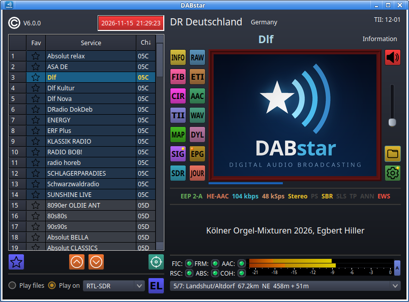

(Fahren Sie mit der Maus über Statuselemente wie **EEP 3-A**, **PS** oder **SBR**, um Tooltip-Informationen zu erhalten.)

Die Statusleiste unter dem MOT-Bild zeigt:

| Anzeige   | Bedeutung                                                                          |
|-----------|------------------------------------------------------------------------------------|
| EEP 3-A   | Der aktuelle (Viterbi-)Fehlerschutzmodus                                           |
| HE-AAC    | Der verwendete Audiodecoder (DAB+: HE-AAC, DAB: MP2)                               |
| 72 kbps   | Eingangsbitrate des AAC-Decoders (einschließlich MOT-Daten)                        |
| 48 kSps   | Die Abtastrate des Audiosignals                                                    |
| Stereo    | Ob der Stereomodus aktiv ist                                                       |
| PS        | Ob Parametric Stereo aktiv ist                                                     |
| SBR       | Ob Spectral Band Replication aktiv ist                                             |
| SLS       | Slideshow: leuchtet dauerhaft, wenn der Dienst sie signalisiert, flackert während MOT-Slideshow-Daten empfangen werden |
| TP        | Traffic Programme: Der Dienst unterstützt Verkehrsdurchsagen (FIG 0/18)           |
| ANN       | Ob gerade eine Durchsage (Announcement) gesendet wird                              |
| EWS       | Das Ensemble nimmt am Emergency Warning System teil (in Deutschland ASA)           |

#### Schaltflächen im Hauptfenster

Die Werkzeug-Schaltflächen im Hauptfenster sind mit Kurztexten beschriftet (fahren Sie mit der Maus darüber, um Tooltip-Informationen zu erhalten):

| Links | Funktion                                                                                                 | Rechts | Funktion                                                                                                    |
|-------|----------------------------------------------------------------------------------------------------------|--------|-------------------------------------------------------------------------------------------------------------|
| INFO  | Zeigt die [Details des gewählten Audiodienstes](#fenster-mit-details-zum-gewählten-audiodienst)          | RAW    | Speichert das rohe Eingangssignal (IQ-Samples) in eine Datei                                                |
| FIB   | Zeigt die Liste des [FIB-Inhalts](#fenster-fib-inhalt)                                                   | ETI    | Speichert den Ensemble-Inhalt als ETI-Datei (kann wieder abgespielt werden, siehe [ETI-Dateiwiedergabe](#eti-dateiwiedergabe)) |
| CIR   | Zeigt die [Kanalimpulsantwort](#prs-korrelationsfenster-über-einen-ganzen-dab-rahmen-cir) (Channel Impulse Response) eines ganzen DAB-Rahmens | AAC    | Speichert die Audio-Frames (AAC oder MP2) in eine Datei                                  |
| TII   | Zeigt die detaillierte [TII-Liste](#tii-liste-mit-details-der-empfangenen-sender) (benötigt die Empfängerkoordinaten in der Konfiguration) | WAV    | Speichert die Audioausgabe als unkomprimierte PCM-Datei                                      |
| MAP   | Zeigt die [Karte](#kartenansicht-der-empfangenen-sender) der empfangenen Sender                          | DYL    | Speichert den Dynamic-Label-Text in eine Datei                                                              |
| SIG   | Zeigt [Spektrum, Konstellation und weitere Ansichten des DAB-Signals](#fenster-scope-spektrum-korrelation-statistik) | EPG    | Öffnet den Programmführer (siehe [EPG](#epg-elektronischer-programmführer)), aktiv, sobald EPG-Daten verfügbar sind |
| SDR   | Zeigt das Bedienfenster des [SDR-Geräts](#einige-der-gerätefenster)                                      | JOUR   | Öffnet das [Journaline](#journaline-fenster)-Fenster, aktiv, sobald Journaline-Daten empfangen werden       |

Die Schaltfläche **EL** öffnet die [Ensemble-Liste](#ensemble-liste), um Live-Kanäle oder Sample-/ETI-Dateien zu durchsuchen.

Schaltflächen, deren Funktion im aktuellen Zustand nicht nutzbar ist (z. B. kein laufender Kanal, ein laufender Suchlauf oder ETI-Dateiwiedergabe), sind deaktiviert.

#### Ampelanzeigen im Hauptfenster

Die Ampelanzeigen liefern in Echtzeit Diagnoseinformationen zu Signalqualität, Synchronisation, Fehlerkorrektur und Audiodekodierung:

| Anzeige   | Bedeutung | Details / Schwellwerte |
|-----------|-----------|------------------------|
| **FIC**   | Qualitätsanzeige für FIC/FIB (Fast Information Channel/Block) | **Grün**: ≥ 95 % FIB-CRC erfolgreich<br>**Gelbgrün**: ≥ 85 % FIB-CRC erfolgreich<br>**Gelb**: ≥ 65 % FIB-CRC erfolgreich<br>**Rotgelb**: ≥ 45 % FIB-CRC erfolgreich<br>**Rot**: < 45 % FIB-CRC erfolgreich *(wenn nicht grün, ist ein Empfang sehr unwahrscheinlich)* |
| **FRM**   | Qualitätsanzeige für Frame-/Superframe-Synchronisation und Fire-Code-Header | **Grün**: 0 Frame-/Superframe-Fehler<br>**Gelbgrün**: 1 Fehler<br>**Gelb**: 2–3 Fehler<br>**Rotgelb**: 4–5 Fehler<br>**Rot**: > 5 Fehler |
| **AAC**   | Qualitätsanzeige für Syntax/Bitstrom der AAC-Kerndekodierung *(nur DAB+)* | **Grün**: 0 AAC-Dekodierfehler<br>**Gelbgrün**: 1 Fehler<br>**Gelb**: 2–3 Fehler<br>**Rotgelb**: 4–5 Fehler<br>**Rot**: > 5 Fehler |
| **RSC**   | Anzeige für Reed-Solomon-/CRC-Fehler *(nur DAB+)* | **Grün**: Fehlerfreier Empfang (keine RS- oder CRC-Fehler)<br>**Gelb**: Fehler erkannt, aber durch Reed-Solomon erfolgreich korrigiert<br>**Rot**: Nicht korrigierbare Fehler (hörbare Aussetzer im Audio) |
| **ABS**   | Anzeige des Audiopufferzustands (Audio Bit Stream) | **Grün**: Pufferfüllstand normal<br>**Rot**: Pufferfüllstand kritisch (zu niedrig oder zu hoch)<br>**Gelbgrün** / **Rotgelb**: Anpassung der Audiorate aktiv (ca. 1 % Anpassung der Audiogeschwindigkeit) |
| **COH**   | Zustandsanzeige der kohärenten Demodulation *(nur aktiv, wenn in der Einstellung „Demodulation“ „Coherent“ gewählt ist)* | **Grün**: Kanalschätzung bereit, kohärente Demodulation in Verwendung<br>**Rotgelb**: Kanalschätzung noch nicht bereit, differentielle Demodulation („Differential, Optimal 3“) in Verwendung<br>**Aus**: Differentielle Demodulation gewählt |

#### SNR- und MER-Balkenanzeige im Hauptfenster

Mit dem Umschaltknopf **A/Q** können Sie zwischen Audiopegel- und SNR/MER-Balkenanzeige wechseln.

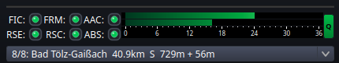

#### Dateiplayer im Hauptfenster

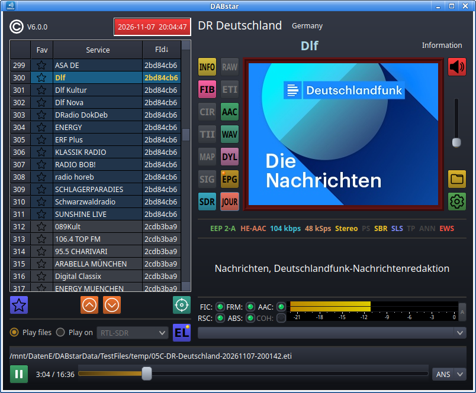

(Hier wird eine ETI-Datei abgespielt, daher sind einige Schaltflächen deaktiviert.)

Wird eine aufgezeichnete IQ-Sample-Datei (RAW, WAV/SDR oder XML) oder eine ETI-Datei (siehe [ETI-Dateiwiedergabe](#eti-dateiwiedergabe)) abgespielt, erscheint im Hauptfenster eine Dateiplayer-Leiste
(im Gerätemodus ist sie ausgeblendet). Sie zeigt:

| Element                | Bedeutung                                                                                     |
|------------------------|-----------------------------------------------------------------------------------------------|
| Dateiname              | Der vollständige Pfad der abgespielten Datei                                                  |
| Play/Pause-Schaltfläche | Hält die Wiedergabe der Datei an oder setzt sie fort                                         |
| Zeit                   | Verstrichene Zeit / Gesamtdauer der Datei                                                     |
| Positionsschieber      | Zeigt die aktuelle Position innerhalb der Datei. Ziehen Sie den Griff (oder klicken Sie auf die Schiene), um an eine andere Position zu springen |
| Aktion am Dateiende    | Was beim Erreichen des Dateiendes passiert: **Stop**, **Loop** oder **ANS** (siehe [Aktion am Dateiende](#aktion-am-dateiende-stop--loop--ans)) |

Dies ersetzt die früheren separaten Dateileser-Fenster.

### Fenster Ensemble-Liste (Gerätemodus)

Die Ensemble-Liste im Geräte-/Kanalsuchlauf-Modus. Die Tabelle zeigt alle bekannten DAB-Kanäle mit ihrem
Suchlaufstatus, Ensemblenamen, Ensemble-ID, ITU-Ländercode, Signalqualität (SNR/MER) und mehr.
Die Farbcodierung verschafft einen schnellen Überblick: Noch nicht durchsuchte Kanäle erscheinen grünlich, erfolgreich durchsuchte
in neutralem Grau, und Kanäle ohne erkennbares Signal sind rot hervorgehoben.

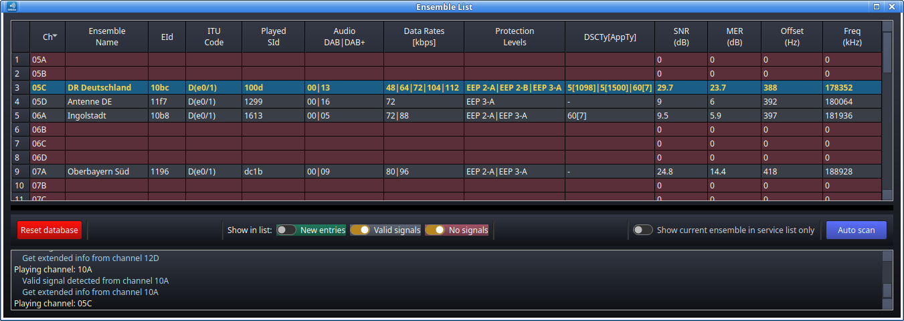

### Fenster Ensemble-Liste (Dateimodus)

Die Ensemble-Liste im Dateiwiedergabe-Modus. Hier können Sie aufgezeichnete DAB-IQ-Sample-Dateien hinzufügen,
sie automatisch durchsuchen lassen und den Überblick behalten, welche Dateien brauchbare DAB-Signale enthalten.
Die Schaltfläche „Remove 'No signal' files“ hilft, die Liste von ungültigen Aufnahmen zu bereinigen.

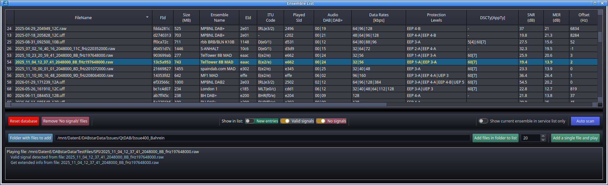

### Konfigurationsfenster

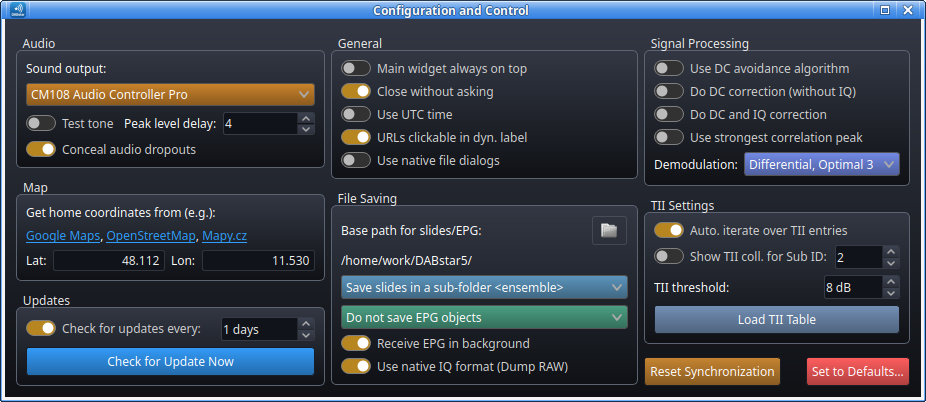


(Ausführliche Erklärungen finden Sie in den Tooltips.)

Mit **Set to Defaults…** werden alle Einstellungen (einschließlich der SDR-Geräteeinstellungen und der Fensterpositionen) auf ihre Standardwerte zurückgesetzt,
und DABstar startet nach einer Bestätigung neu. Erhalten bleiben die Heimatkoordinaten, die Verzögerung der Spitzenpegelanzeige, die TII-Datenbankdatei sowie die
Einträge der durchsuchten Dienste und Ensembles in den Datenbanken. Die Datei `fftwf_wisdom.txt` wird gelöscht und neu erzeugt.

### Fenster Scope, Spektrum, Korrelation, Statistik

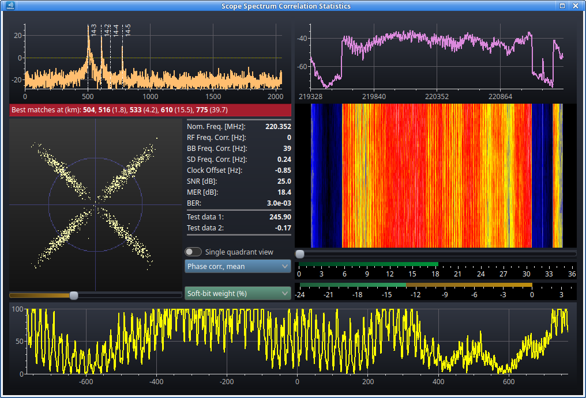

Zeigt Spektrum-Scope, IQ-Konstellation, Impulsantwort/Korrelation und trägerbezogene Größen mit interaktivem horizontalem und vertikalem Zoomen/Verschieben.

### Fenster FIB-Inhalt

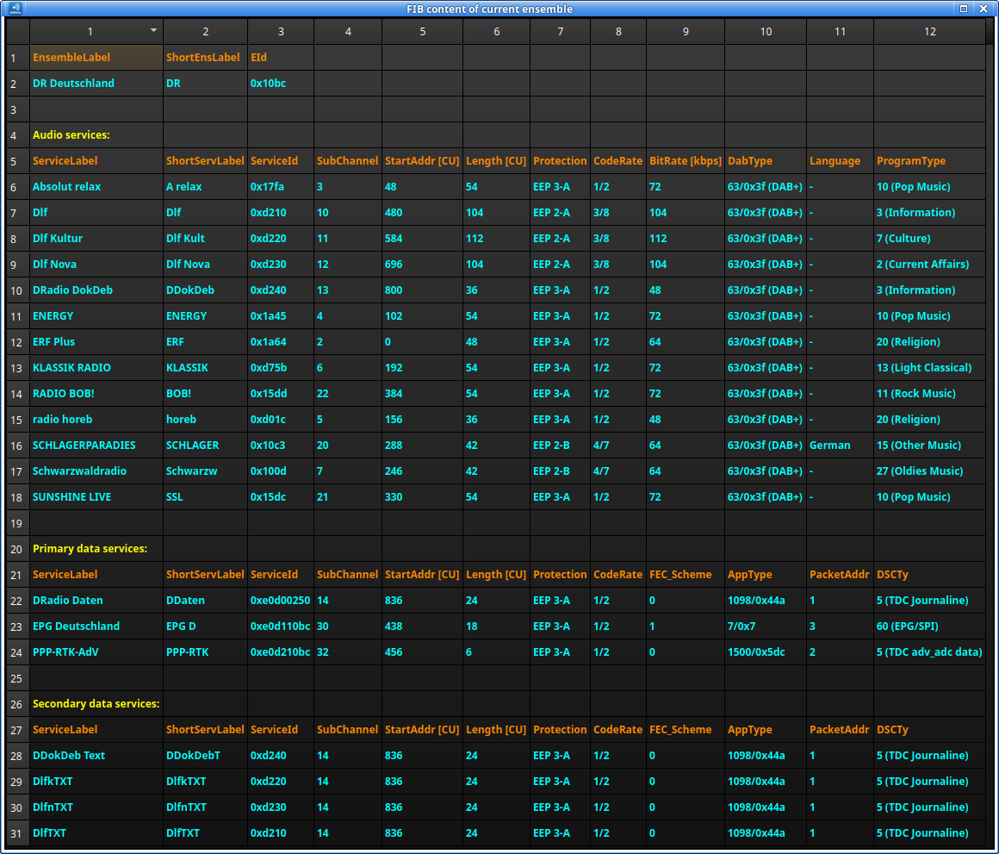

### Journaline-Fenster

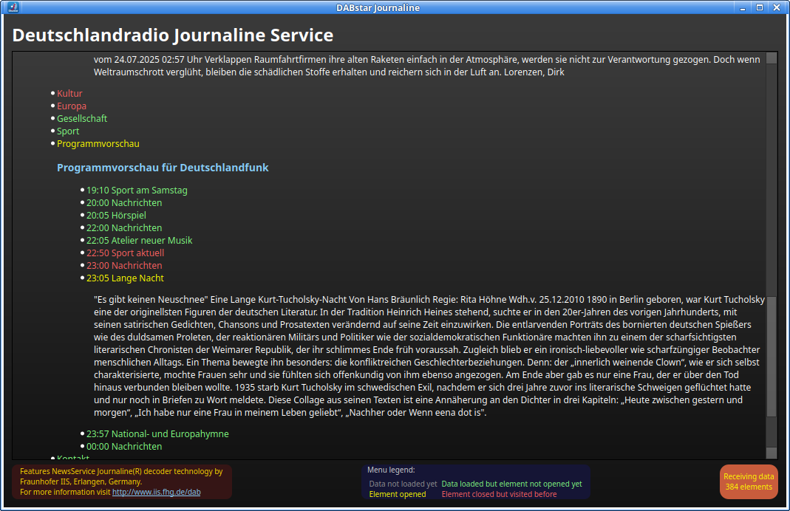

Journaline wird als eigenständiger Datendienst unterstützt und ebenso, wenn es innerhalb des X-PAD eines Audiodienstes übertragen wird (signalisiert über FIG 0/13).

### EPG-Fenster

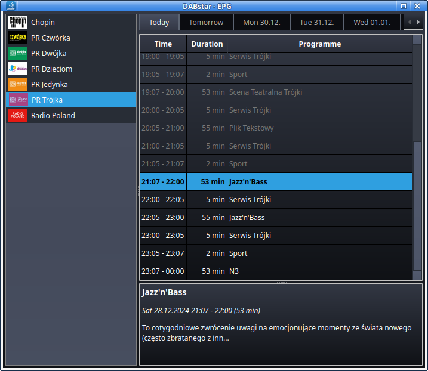

Zeigt den Programmführer des aktuellen Ensembles, siehe [EPG](#epg-elektronischer-programmführer).

### TII-Liste mit Details der empfangenen Sender

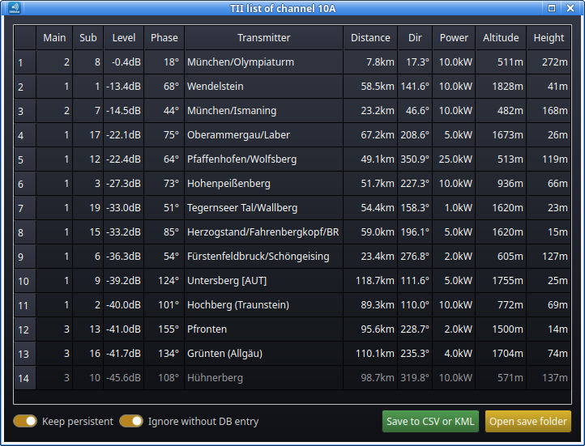

Zeigt die erkannten Senderkennungen (Transmitter Identification Information, TII) einschließlich Main-/Sub-ID, Senderstandort, Entfernung, Azimut und Signalstärke. Die Senderliste kann direkt im CSV- oder KML-Format exportiert werden, etwa für die Darstellung in externen Karten oder für Ausbreitungsanalysen.

### Kartenansicht der empfangenen Sender

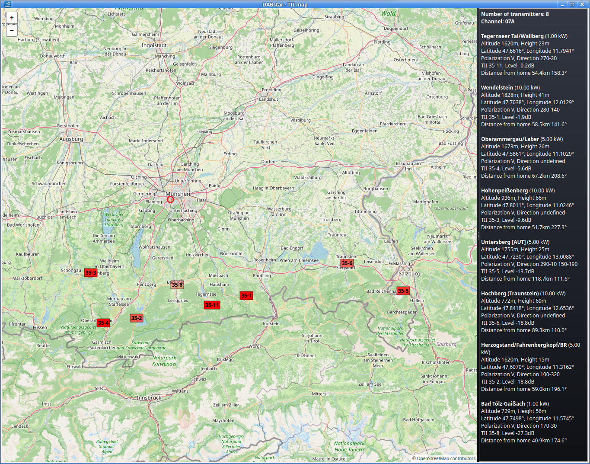

Die Karte wird direkt in einem eigenen DABstar-Fenster dargestellt (die Kartenkacheln werden von OpenStreetMap geladen und lokal zwischengespeichert).
Ziehen Sie mit der Maus, um die Karte zu verschieben, zoomen Sie mit dem Mausrad oder per Doppelklick, und klicken Sie auf einen Sender, um seine Details anzuzeigen.

### Dialog zur Programmaktualisierung

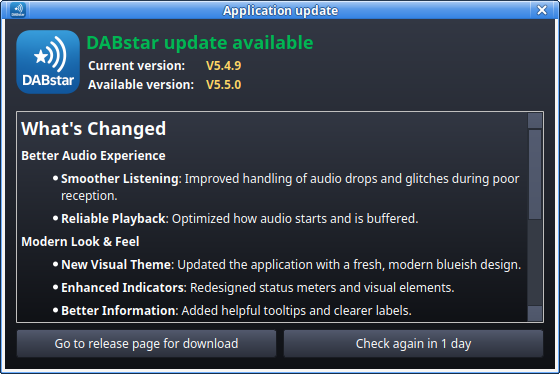

### Fenster mit Versions- und Copyright-Informationen

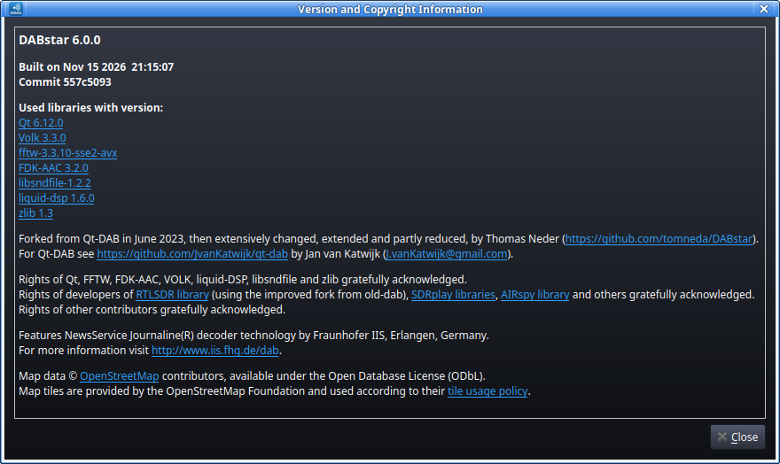

### Fenster mit Details zum gewählten Audiodienst

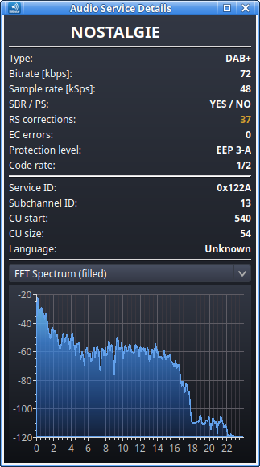
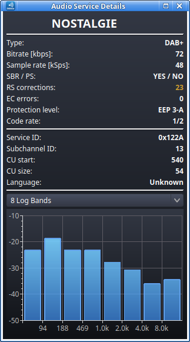

Die Audioanzeige unterstützt mehrere Darstellungsarten (FFT-Spektrum ungefüllt/gefüllt, 8 logarithmische Bänder oder aus) mit interaktivem horizontalem und vertikalem Zoomen/Verschieben.

### PRS-Korrelationsfenster über einen ganzen DAB-Rahmen (CIR)

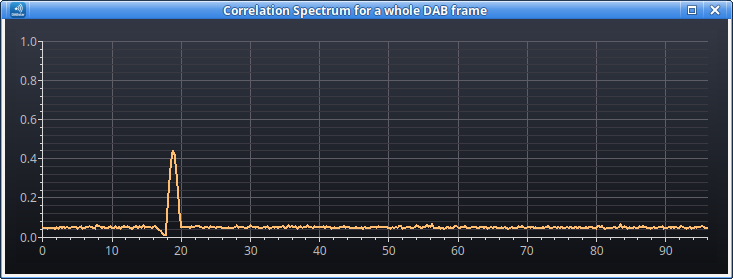

### Einige der Gerätefenster

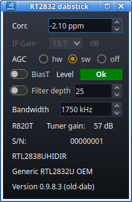
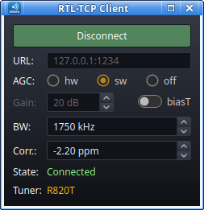
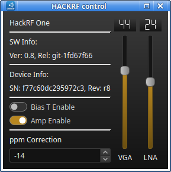
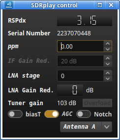

Die Gerätekonfigurationsfenster bieten hardwarespezifische Einstellungen (Verstärkung, AGC, PPM-Korrektur, Bandbreite). Unterstützte RTL-SDR- und RTL-TCP-Geräte zeigen zusätzlich den erkannten Tuner-Chiptyp (z. B. R820T, R828D, E4000, FC0012/13, FC2580) sowie Bibliotheks-/Firmware-Informationen an.

---

## Releases
Die aktuellen AppImage-Versionen finden Sie auf der
[Linux-Release-Seite](https://github.com/tomneda/DABstar/releases/).

[old-dab](https://github.com/old-dab) stellt auch Windows-Versionen bereit, siehe die
[Windows-Release-Seite](https://github.com/old-dab/DABstar/releases).
Der Funktionsumfang kann sich zwischen Linux und Windows etwas unterscheiden, selbst bei gleicher Versionsnummer.

## Einführung und Geschichte
Der Vorgänger von [DABstar](https://github.com/tomneda/DABstar) wurde im Juni 2023 ursprünglich von Jan van Katwijks großartiger Arbeit [Qt-DAB](https://github.com/JvanKatwijk/qt-dab)
abgespalten (Fork), und zwar von [Commit](https://github.com/JvanKatwijk/qt-dab/commits/b083a8e169ca2b7dd47167a07b92fa5a1970b249) ([Tree](https://github.com/JvanKatwijk/qt-dab/tree/b083a8e169ca2b7dd47167a07b92fa5a1970b249)) vom 30.05.2023. Einige danach in Qt-DAB vorgenommene Korrekturen und Anpassungen sind übernommen.

Da inzwischen (nicht nur gefühlt) Hunderte bis Tausende Arbeitsstunden darin stecken, es riesige Änderungen und Ergänzungen (aber auch Reduzierungen) gab und es auch in Zukunft größere Änderungen geben wird,
habe ich mich entschieden, dem Projekt den neuen Namen **DABstar** zu geben.

Mir ist aufgefallen, dass Qt-DAB seit Version 6.x auch neue Codeteile und Ideen von hier verwendet. Das freut mich sehr :smiley:.
Es ist sehr erfüllend, dass meine Arbeit etwas zurückgeben kann.

Ich versuche, auf dem aktuellen Stand des `main`-Branches stets einen funktionierenden Zustand zu halten; verwenden Sie diesen also, um die Software selbst zu bauen.
**Bitte verwenden Sie keinen anderen Branch als den `main`-Branch.**
Die anderen Branches dienen der Entwicklung, Sicherung und für Tests und funktionieren in ihrem aktuellen Zustand nicht immer.

Empfohlen ist, einen [Tag](https://github.com/tomneda/DABstar/tags) einer veröffentlichten Version auszuchecken, diese sind besser getestet.

Seit Herbst 2024 trägt [old-dab](https://github.com/old-dab) wesentlich zu DABstar bei, insbesondere bei Synchronisation, Dekodierung und Performance – vielen Dank dafür!


## Ensemble-Liste

Die **Ensemble-Liste** ist ein eigenes Fenster zum Katalogisieren und Durchsuchen von DAB-Ensembles (Gruppen von Radiosendern), entweder über ein
angeschlossenes SDR-Gerät oder aus zuvor aufgezeichneten IQ-Sample-Dateien.

**So wird sie geöffnet:** Klicken Sie in der Werkzeugleiste des Hauptfensters auf die blaue Schaltfläche „EL“ (Ensemble List).

### Zwei Betriebsarten
(Auswahl im Hauptfenster, links neben der Schaltfläche „EL“)

| Betriebsart                    | Beschreibung                                                                                                         |
|--------------------------------|----------------------------------------------------------------------------------------------------------------------|
| Geräte-/Kanalsuchlauf          | Durchsucht alle Standard-DAB-Kanäle über das angeschlossene SDR-Gerät und speichert das Ergebnis für jeden Kanal.    |
| Dateisuchlauf                  | Durchsucht einen Ordner (oder mehrere Ordner) mit aufgezeichneten DAB-IQ-Dateien und katalogisiert, welche davon gültige Signaldaten enthalten. |

### Bedienelemente

| Bedienelement                              | Modus     | Beschreibung                                                                                                                                                                                                                                      |
|--------------------------------------------|:----------|---------------------------------------------------------------------------------------------------------------------------------------------------------------------------------------------------------------------------------------------------|
| Reset database                             | beide     | Löscht die gesamte Datenbank des aktuellen Modus. Damit lässt sich ein vollständiger neuer Suchlauf erzwingen. *Hinweis: Das erneute Durchsuchen vieler Dateien dauert eine Weile.*                                                               |
| Show current ensemble in service list only | beide     | Filtert die **Dienstliste** im Hauptfenster, sodass nur das aktuell gewählte Ensemble angezeigt wird.                                                                                                                                             |
| Auto Scan                                  | beide     | Durchsucht alle aktuell in der Liste sichtbaren Einträge. Einzelne Zeilen können auch durch direktes Anklicken durchsucht werden.                                                                                                                  |
| Remove 'No signal' files                   | nur Datei | Entfernt Einträge, bei denen kein gültiges DAB-Signal gefunden wurde. Damit die Schaltfläche aktiv ist, muss die Filter-Checkbox „No signal“ gesetzt sein.                                                                                         |
| Folder with files to add                   | nur Datei | Legt den Ordnerpfad fest, dessen Dateien der Datenbank hinzugefügt werden.                                                                                                                                                                        |
| Add files in folder to list                | nur Datei | Fügt alle Dateien des gewählten Ordners der Datenbank hinzu. Auch Nicht-Sample-Dateien werden angenommen und beim Suchlauf als ungültig markiert. Mindestens 4 MB pro Datei; höchstens 10 000 Dateien, um das System nicht auszubremsen.            |
| Minimum file size (MB)                     | nur Datei | Dateien unterhalb dieser Größe werden beim Hinzufügen zur Datenbank übersprungen.                                                                                                                                                                 |
| Add a single file and play                 | nur Datei | Fügt eine einzelne Aufnahme der Datenbank hinzu und startet sofort die Wiedergabe. Ersetzt die frühere Schaltfläche „Eject“. Ist die Datei bereits in der Datenbank, wird sie ausgewählt und abgespielt. Die Mindestgröße gilt hier nicht (nur das feste Minimum von 4 MB). |

### Farbcodierung in der Tabelle

Die Tabelle verwendet Hintergrundfarben für einen schnellen Statusüberblick:

| Farbe    | Bedeutung                                 |
|----------|-------------------------------------------|
| Grünlich | Kanal / Datei noch nicht durchsucht       |
| Gräulich | Erfolgreich durchsuchter Eintrag          |
| Rötlich  | Kein Signal erkannt (fehlgeschlagen)      |

### Filter-Checkboxen

Drei Filter-Checkboxen steuern, welche Einträge in der Tabelle sichtbar sind.
Ihr Zustand kann sich automatisch ändern, wenn eine bestimmte Suchlaufsituation eintritt.

| Checkbox    | Zeigt                                                 |
|-------------|-------------------------------------------------------|
| Not scanned | Einträge, die noch nicht durchsucht wurden            |
| Scanned     | Einträge, für die bereits Suchlaufdaten vorliegen     |
| No signal   | Einträge, bei denen kein gültiges DAB-Signal gefunden wurde |

### Gespeicherte Daten pro Ensemble

Die SQLite-Datenbank speichert für jeden Eintrag die folgenden Informationen (die genauen Felder unterscheiden sich zwischen Geräte- und Dateimodus):

| Feld                 | Beschreibung                                                                                     |
|----------------------|--------------------------------------------------------------------------------------------------|
| Kanal / Dateipfad    | Name des DAB-Kanals (Gerätemodus) oder vollständiger Dateipfad (Dateimodus)                      |
| FId                  | Eindeutige Dateikennung – Hash über einen Teil des Dateiinhalts (nur Dateimodus)                 |
| Ensemblename & EId   | Lesbarer Name des Ensembles und seine numerische Ensemble-ID                                     |
| ITU-Ländercode       | Herkunftsland, kodiert nach ITU-Standard                                                         |
| Frequenz             | Nennfrequenz (falls bekannt)                                                                     |
| Offset               | Der gemessene Basisband-Offset                                                                   |
| Fehlerschutz         | Fehlerschutzstufe und Parameter des Schutzverfahrens                                             |
| DSCTy / AppType      | Informationen zum Diensttyp, z. B. Journaline, EPG                                               |
| SNR / MER            | Signal-Rausch-Verhältnis (Signal-to-Noise Ratio) und Modulation Error Ratio                      |
| Last SId             | Zuletzt gespielte Service-ID – dient dazu, nach einem Ensemblewechsel denselben Dienst fortzusetzen |
| Datum                | Das im DAB-Signal kodierte Datum (UTC)                                                           |
| Suchlaufstufe        | Höchste erreichte Suchlaufstufe (wird in der Liste nicht als Spalte angezeigt)                   |

---

## Dienstliste

Die Dienstauswahl auf der linken Seite des Hauptfensters wird als SQLite-Datenbank im
Ordner `~/.config/dabstar` gespeichert.

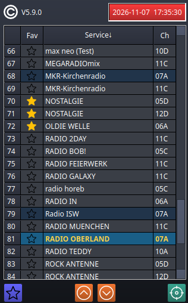

Der aktuell gewählte Dienst wird mit hellblauem Hintergrund und fettem gelbem Text dargestellt.
In den dunkelblau gefärbten Einträgen finden Sie weitere Dienste desselben Kanals.
Beim Anklicken solcher Dienste ist die Umschaltzeit recht kurz.

Die Dienste mit grauem Hintergrund stammen von einem anderen Kanal.
Wählt man einen davon, dauert es etwas länger (ca. 3 Sekunden), bis Audio zu hören ist.

### Favoriten

Sie können einen gerade laufenden Dienst durch Klick auf  als Favoriten markieren.
Ein erneuter Klick auf dieselbe Schaltfläche hebt die Favoritenmarkierung wieder auf.
Auf der linken Seite der Dienstliste sehen Sie, ob ein Dienst als Favorit markiert ist.
Die Favoriten werden getrennt von der Dienstliste gespeichert, sodass ein erneuter Suchlauf sie nicht löscht.

### Sortierung

Durch Klick auf einen Spaltenkopf können Sie die Sortierung ändern. Bei Auswahl der Spalte „Fav“ stehen
die Favoriten immer oben, während die Dienstspalte (auf- oder absteigend) sortiert wird.

### Kanal-Schaltflächen

Mit den Auf/Ab-Schaltflächen  können Sie in der Liste einen Dienst nach oben oder unten weiterschalten (am Listenende geht es am anderen Ende weiter).
Ändern Sie die Sortierung der Liste, wenn Sie hauptsächlich innerhalb der Favoriten oder innerhalb desselben Kanals weiterschalten möchten.

### Ziel-Schaltfläche

Wenn Sie den aktuell gewählten Dienst in der Liste „aus den Augen verloren“ haben, klicken Sie auf diese Schaltfläche .
Der aktuelle Dienst wird dann (wenn möglich) in der Mitte der Liste angezeigt.

### Aktion am Dateiende (Stop / Loop / ANS)

Dies ist nur im Dateimodus aktiv. Mit dem Auswahlfeld in der Dateiplayer-Leiste des Hauptfensters legen Sie fest, was beim Erreichen des Dateiendes geschieht:

| Aktion | Beschreibung                                                                                                  |
|--------|---------------------------------------------------------------------------------------------------------------|
| Stop   | Die Wiedergabe wird am Anfang der Datei angehalten. Drücken Sie die Play-Schaltfläche, um sie erneut abzuspielen. |
| Loop   | Die Datei wird von vorn wiedergegeben, der aktuelle Dienst bleibt erhalten (Standard).                        |
| ANS    | Automatic Next Service: Die Datei wird von vorn wiedergegeben und der nächste Dienst in der Dienstliste gewählt. |

Mit ANS können Sie jeden Dienst nacheinander in einem durchgehenden Strom anhören.
Zusätzlich lassen sich so alle Slideshow-Bilder der Dienste in den Dateien erfassen.


### Hinweise zum Suchlauf

Für einen erfolgreichen Empfang ist eine gute Pegeleinstellung des Geräts notwendig.
Klicken Sie auf **SDR**, um das Gerätefenster zu öffnen (es unterscheidet sich je nach Gerät).
Die beste Rückmeldung zur Signalqualität liefert der **Spectrum Scope**, den Sie mit **SIG** öffnen.
Die Details dort ausführlich zu erklären, würde hier zu weit führen. Weitere Hilfe bieten die dortigen Tooltips.

Auch die Uhr oberhalb der Dienstliste kann als Indikator dienen. Die Uhrzeit wird nur angezeigt (und der Hintergrund leuchtet auf), wenn die DAB-Zeitinformation
empfangen werden kann.


## EPG (Elektronischer Programmführer)

Viele Ensembles enthalten einen EPG-Dienst mit den Programmplänen und weiteren Informationen zu ihren Diensten.
In den aktuellen ETSI-Standards heißt der EPG SPI (Service and Programme Information; ETSI TS 102 818 für das Datenmodell und ETSI TS 102 371 für die in DAB verwendete Binärkodierung).
DABstar verwendet in seiner Oberfläche den geläufigeren Begriff „EPG“.
DABstar empfängt ihn **im Hintergrund**, unabhängig vom gewählten Audiodienst. Der EPG-Dienst selbst muss also nicht ausgewählt werden.

- Ein- oder ausgeschaltet wird dies mit „Receive EPG in background“ im Konfigurationsfenster (eine Änderung wird mit der nächsten Kanalwahl wirksam).
  Während eines Suchlaufs wird kein EPG empfangen.
- Die Schaltfläche **EPG** im Hauptfenster wird aktiv, sobald EPG-Daten des Ensembles verfügbar sind. Sie flackert, während EPG-Daten empfangen werden.
- Klicken Sie auf **EPG**, um das EPG-Fenster zu öffnen (oder zu schließen):

| Bereich        | Beschreibung                                                                                                                        |
|----------------|-------------------------------------------------------------------------------------------------------------------------------------|
| Dienstliste    | Die Dienste mit Programmdaten (mit Logos, sofern übertragen). Der gerade gespielte Dienst ist vorausgewählt. Ein Doppelklick auf einen Dienst wählt ihn aus (und spielt ihn ab). |
| Tages-Tabs     | Wahl des Tages der angezeigten Sendungen.                                                                                           |
| Sendungsliste  | Start-/Endzeit, Dauer und Titel jeder Sendung. Die gerade laufende Sendung ist hervorgehoben, vergangene Sendungen sind abgeblendet. |
| Details        | Zeiten, Kurz- und Langbeschreibung der gewählten Sendung.                                                                           |

Die Zeiten werden in der Ortszeit des Ensembles angezeigt (da die Sendungen in dieser Zeit angekündigt werden) bzw. in UTC, wenn „Use UTC time“ gewählt ist.

Optional können die empfangenen EPG-Objekte im Ordner `EPG/` unterhalb des Basispfads für Slides/EPG gespeichert werden (siehe Konfigurationsfenster).

## ETI-Dateiwiedergabe

Neben IQ-Sample-Dateien lassen sich auch aufgezeichnete ETI(NI)-Dateien (z. B. mit der Dump-Schaltfläche **ETI** erstellt) wie jede andere Datei öffnen.
Der Dateityp wird anhand des Dateiinhalts erkannt.

Da eine ETI-Datei die bereits dekodierten Daten des Ensembles enthält (keine IQ-Samples), sind die Fenster, die IQ-Samples benötigen,
in diesem Modus nicht verfügbar: Spectrum Scope (**SIG**), **CIR**, **TII**, die Karte (**MAP**) und die SNR/MER-Balkenanzeige. Auch die Dump-Schaltflächen ETI und RAW sind deaktiviert.
Bereits geöffnete Fenster dieser Art werden während der Wiedergabe einer ETI-Datei ausgeblendet und danach wieder angezeigt.

## Kohärente Demodulation

Neben der klassischen differentiellen Demodulation (DQPSK, das vorherige OFDM-Symbol dient als Phasenreferenz) bietet DABstar eine **kohärente Demodulation**.
Sie wird im Konfigurationsfenster über die Einstellung „Demodulation“ gewählt:

| Einstellung                    | Beschreibung                                                                                                                      |
|--------------------------------|-----------------------------------------------------------------------------------------------------------------------------------|
| Coherent                       | Verwendet statt des vorherigen Symbols eine Kanalschätzung als Phasenreferenz. Benötigt bei schwachen, stationären Signalen weniger SNR. |
| Differential, Optimal 1 bis 3  | Differentielle Demodulation mit unterschiedlicher Soft-Bit-Erzeugung (Standard ist „Differential, Optimal 3“)                     |

Bei der kohärenten Demodulation wird die Kanalschätzung aus dem Phasenreferenzsymbol über mehrere Rahmen gemittelt, und die Phasen- und Zeitdrift wird innerhalb des Rahmens nachgeführt.
Solange die Kanalschätzung noch nicht bereit ist, wird „Differential, Optimal 3“ verwendet. Die Ampelanzeige **COH** im Hauptfenster zeigt den aktuellen Zustand.

Die kohärente Demodulation wurde von [welle.io](https://github.com/AlbrechtL/welle.io) übernommen.
Vielen Dank an die Entwickler von welle.io für diese großartige Arbeit!

## Konfigurations- und Datendateien

DABstar speichert seine Konfiguration und Datenbanken im Verzeichnis `~/.config/dabstar`:

- `settings03.ini`: Programmkonfiguration, Fensterlayouts, SDR-Einstellungen, Koordinaten und Farbschemata.
- `dabstar06.db`: SQLite-Datenbank mit der Ensemble-Liste (Kanal- und Dateisuchlauf-Einträge), den durchsuchten Diensten und den Favoriten.
  Die früheren Dateien `servicelist04.db` und `ensemblelist04.db` werden nicht mehr verwendet und können gelöscht werden.
- `fftwf_wisdom.txt`: FFTW-Wisdom-Datei. Sie speichert die Ergebnisse der FFT-Planung (FFTW_MEASURE), sodass das (langsame) Ausmessen nur einmal erfolgt.
  Daher dauert der allererste Start von DABstar (oder der erste Start nach einem FFTW-Update) etwas länger.

## Installation unter Linux aus dem aktuellen Mainline-Stand

Folgendes wird benötigt, um DABstar unter Ubuntu zu installieren (getestet unter Ubuntu 24.04).
Ein C++20-fähiger Compiler ist erforderlich (z. B. GCC ≥ 11; der Standard-GCC 13 von Ubuntu 24.04 passt).

```bash
sudo apt-get update
sudo apt-get install -y \
    git cmake build-essential g++ \
    libsndfile1-dev libfftw3-dev zlib1g-dev libusb-1.0-0-dev \
    qt6-base-dev qt6-multimedia-dev qt6-charts-dev
```

### VOLK installieren

Mehrere Teile (u. a. der OFDM-Decoder und die Frequenzkorrektur) verwenden die Bibliothek [VOLK](https://www.libvolk.org/)
(Vector-Optimized Library of Kernels) für SIMD-vektorisierte Signalverarbeitungsoperationen.
Das senkt die CPU-Last spürbar, besonders auf Rechnern mit SSE/AVX-fähigen Prozessoren.
Empfohlen wird VOLK in Version 3.3.0 oder neuer.

Ubuntu 24.04 liefert VOLK 3.1 aus; installieren Sie die paketierte Version oder bauen Sie für ≥ 3.3.0 aus den Quellen:
```bash
sudo apt-get install libvolk-dev
```
oder aus den Quellen bauen:
```bash
git clone --recursive https://github.com/gnuradio/volk.git
cd volk
mkdir build && cd build
cmake .. -DCMAKE_BUILD_TYPE=Release
make -j4
sudo make install
sudo ldconfig
```
Aktivieren Sie VOLK im DABstar-Build, indem Sie dem `cmake`-Aufruf `-DSSE_OR_AVX=ON` hinzufügen (siehe unten).

### FDK-AAC installieren

Da libfaad Probleme mit Diensten niedriger Bitrate hatte, verwendet DABstar Fraunhofer FDK-AAC. FDK-AAC bietet außerdem eine gut funktionierende Verschleierung von Audioaussetzern.
Da die Paketversion mancher Linux-Distributionen Fehler bei PS-Diensten (Parametric Stereo) hat, wird empfohlen, aus den Quellen zu bauen.
Ich habe die neueste getaggte Version v2.0.3 verwendet (enthält die AAC-Decoder-Bibliothek v3.2.0):
```bash
git clone https://github.com/mstorsjo/fdk-aac.git
cd fdk-aac
git checkout v2.0.3
mkdir build && cd build
cmake ..
make -j4
sudo make install
sudo ldconfig
```

### DABstar bauen
```bash
git clone https://github.com/tomneda/DABstar.git
cd DABstar
mkdir build && cd build
cmake .. -DAIRSPY=ON -DSPYSERVER=ON -DSDRPLAY=ON -DHACKRF=ON -DLIMESDR=ON -DRTL_TCP=ON -DPLUTO=ON -DUHD=ON -DRTLSDR=ON -DSOAPY=ON -DVITERBI_AVX2=ON -DFDK_AAC=ON -DSSE_OR_AVX=ON
make -j4
```

#### CMake-Build-Optionen

Über CMake-Flags können Sie den Build anpassen und nur die SDR-Hardware und Optimierungen aktivieren, die Sie benötigen:

##### Unterstützte SDR-Hardware

| CMake-Option | Standard | Beschreibung |
|---|---|---|
| `-DRTLSDR=ON` | ON | RTL-SDR-USB-Sticks |
| `-DRTL_TCP=ON` | OFF | RTL-TCP-Client für SDR im Netzwerk |
| `-DAIRSPY=ON` | OFF | AirSpy SDR |
| `-DSPYSERVER=ON` | OFF | SpyServer-Client für SDR im Netzwerk |
| `-DHACKRF=ON` | OFF | Great Scott Gadgets HackRF One |
| `-DSDRPLAY=ON` | OFF | SDRplay-RSP-Geräte (RSP1, RSP1A, RSP2, RSPduo, RSPdx) |
| `-DPLUTO=ON` | OFF | Analog Devices ADALM-PLUTO SDR |
| `-DLIMESDR=ON` | OFF | Lime Microsystems LimeSDR |
| `-DUHD=ON` | OFF | Ettus Research USRP UHD |
| `-DSOAPY=ON` | OFF | SoapySDR, generischer Geräte-Wrapper |

##### DSP-, SIMD- und Dekodier-Optionen

| CMake-Option | Standard | Beschreibung |
|---|---|---|
| `-DVITERBI_AVX2=ON` | OFF | 16-fach-AVX2-SIMD-Viterbi-Decoder (am schnellsten auf modernen x86_64-CPUs) |
| `-DVITERBI_SSE2=ON` | OFF | SSE2-SIMD-Viterbi-Decoder (für ältere x86_64-CPUs) |
| `-DVITERBI_NEON=ON` | OFF | ARM-NEON-SIMD-Viterbi-Decoder (für ARM / Raspberry Pi) |
| `-DSSE_OR_AVX=ON` | OFF | Vektorisierte OFDM-Dekodierung und Frequenzkorrektur (benötigt VOLK) |
| `-DFDK_AAC=ON` | ON | Hochwertiger Fraunhofer-FDK-AAC-Audiodecoder |
| `-DUSE_LIQUID=ON` | OFF | Liquid DSP für Halbbandfilter und Resampler (benötigt liquid-dsp) |
| `-DDATA_STREAMER=ON` | OFF | Streamer für Rohdaten über TCP |

##### Empfohlene Minimalkonfiguration (RTL-SDR auf x86_64)

```bash
cmake .. -DRTLSDR=ON -DVITERBI_AVX2=ON -DSSE_OR_AVX=ON
```
*(Verwenden Sie `-DVITERBI_SSE2=ON` statt `-DVITERBI_AVX2=ON`, wenn Ihr Prozessor kein AVX2 unterstützt.)*

Um das Kompilieren zu beschleunigen, können Sie dem `make`-Befehl das Argument `-j<n>` mit `<n>` als Anzahl der Threads mitgeben, z. B. `make -j4`.
Wählen Sie keine zu hohe Zahl, da dem System sonst der Speicher ausgehen kann!

Optional können Sie im Build-Ordner die Unit-Tests ausführen mit
```bash
ctest
```
(das Bauen der Tests lässt sich mit `-DBUILD_TESTING=OFF` abschalten).

Schließlich finden Sie im Build-Ordner die Programmdatei, die Sie starten können mit
```bash
./dabstar
```

Sie können versuchen, die Software im System zu installieren mit
```bash
sudo make install
sudo ldconfig
```
Um DABstar wieder zu deinstallieren:
```bash
sudo make uninstall
```

#### Bauen mit qmake

Alternativ lässt sich DABstar mit qmake über `dabstar.pro` bauen. Unter Windows werden die Bibliotheken aus `../dabstar-libs` verwendet.
Unter Linux werden die Bibliotheken per pkg-config aus dem System genommen (dieselben Pakete wie beim CMake-Build).
Die Optionen werden über die Zeilen `CONFIG += ...` am Anfang von `dabstar.pro` gewählt. Unter Linux wird eine Option
automatisch (mit einer Meldung) deaktiviert, wenn ihre Bibliothek oder ihr Header nicht installiert ist. Ohne FDK-AAC wird stattdessen libfaad verwendet.

```bash
mkdir build-qmake && cd build-qmake
qmake6 ../dabstar.pro
make -j4
```

### Installation des RTL-SDR-Treibers

Es wird empfohlen, die RTL-SDR-Bibliothek aus dem Repository von old-dab aus den Quellen zu bauen. Siehe https://github.com/old-dab/rtlsdr.

Es wird dann außerdem empfohlen, den Standardtreiber zu entfernen, falls er installiert ist.

Wenn Sie beim Betrieb von DABstar den Standardtreiber verwenden, erhalten Sie ein Hinweisfenster dazu; DABstar funktioniert aber trotzdem einigermaßen damit.

Der Treiber von old-dab sollte weiterhin kompatibel mit anderen Anwendungen sein, die diesen Treiber verwenden.

Den Standardtreiber entfernen Sie mit:
```bash
sudo apt remove rtl-sdr librtlsdr-dev
sudo ldconfig
```


Wenn Sie dennoch die Standardversion von Ubuntu verwenden möchten (was nicht empfohlen wird, da der Treiber von old-dab einige Verbesserungen enthält):
```bash
sudo apt install rtl-sdr librtlsdr-dev
sudo ldconfig
```

### USRP UHD installieren

Am besten funktioniert hat bei mir UHD aus dem Repository von Ettus Research.

```bash
sudo add-apt-repository ppa:ettusresearch/uhd
sudo apt-get update
sudo apt-get install libuhd-dev uhd-host
```

### AirSpy installieren

Details siehe https://github.com/airspy/airspyone_host

```bash
git clone https://github.com/airspy/airspyone_host.git
cd airspyone_host
mkdir build && cd build
cmake ../ -DINSTALL_UDEV_RULES=ON
make -j4
sudo make install
sudo ldconfig
```

## Lizenzen

Die Rechte an Qt-DAB, AbracaDABra, welle.io, Qt, FFTW, VOLK, FDK-AAC, libfaad und libsndfile werden dankbar anerkannt.

Die Rechte der Entwickler der RTLSDR-Bibliothek, der SDRplay-Bibliotheken, der AIRspy-Bibliothek und weiterer werden dankbar anerkannt.

Die Rechte von old-dab und weiteren Mitwirkenden werden dankbar anerkannt.

Die verwendeten Icons stammen von [FlatIcon](https://www.flaticon.com/). Die Arbeit der Icon-Autoren wird dankbar anerkannt:

| Icon-Set                                                   | Autor         |
|------------------------------------------------------------|---------------|
| [Target icons](https://www.flaticon.com/free-icons/target) | Pixel perfect |
| [Folder icons](https://www.flaticon.com/free-icons/folder) | gariebaldy    |

### OpenStreetMap

Kartendaten © [OpenStreetMap](https://www.openstreetmap.org/copyright)-Mitwirkende, verfügbar unter der Open Database License (ODbL).
Die Kartenkacheln werden von der OpenStreetMap Foundation bereitgestellt und gemäß deren [Tile Usage Policy](https://operations.osmfoundation.org/policies/tiles/) verwendet.

### Journaline

Features NewsService Journaline(R) decoder technology by
Fraunhofer IIS, Erlangen, Germany.
For more information visit http://www.iis.fhg.de/dab

(Enthält die Decodertechnologie NewsService Journaline(R) des Fraunhofer IIS, Erlangen. Weitere Informationen unter http://www.iis.fhg.de/dab)
