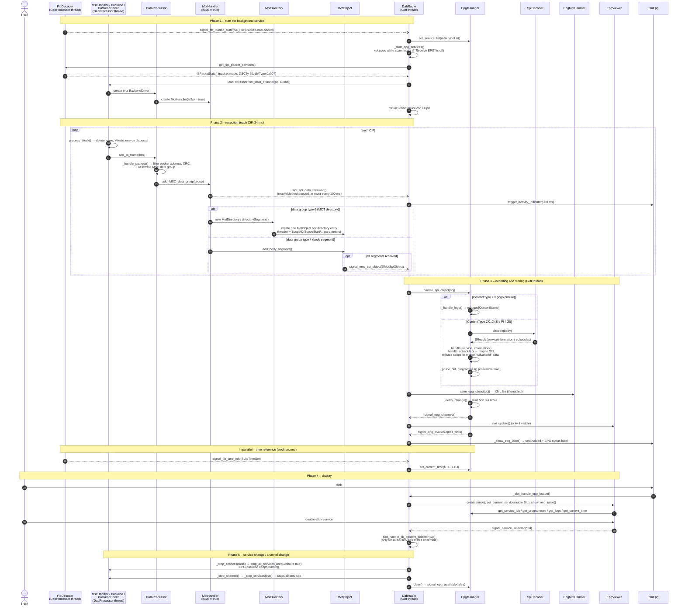

# EPG (SPI) data flow

Message sequence chart of the reception of the "Service and Programme Information" (SPI, formerly EPG, ETSI TS 102 371)
in DABstar.

Dashed arrows are queued signals (thread change from the `DabProcessor` thread to the GUI thread). By default the backend
is not threaded (`__THREADED_BACKEND__` is not defined), so the decoding up to the complete MOT object runs within the
`DabProcessor` thread.

## Remarks

- **X-PAD path** (not shown): SPI carried in the X-PAD of an audio service takes the path `PadHandler` → `MotObject`
  (not marked as SPI) → `DabRadio::slot_handle_mot_object()`. Objects with ContentType 7/0..2 are wrapped into an
  `SMotSpiObject` and join the chart at `handle_spi_object()`.
- If the secondary packet component of the selected audio service is the same SPI stream as a running global EPG
  service, no second backend is created (`isRunningAsGlobal` in `DabRadio::_start_primary_and_secondary_service()`).
- Body segments (data group type 4) without a known header or directory entry are dropped in `MotHandler`, the
  carousel repeats them.
- Compressed SPI objects ("Advanced" profile, MOT parameter CompressionType) and encrypted objects (CAInfo) are ignored
  by the `EpgManager`.

## Involved files

| Class            | File                                                     |
|------------------|----------------------------------------------------------|
| `FibDecoder`     | `src/base/decoder/fib_decoder.cpp`                       |
| `MscHandler`     | `src/base/backend/msc_handler.cpp`                       |
| `DataProcessor`  | `src/base/backend/data/data_processor.cpp`               |
| `MotHandler`     | `src/base/backend/data/mot/mot_handler.cpp`              |
| `MotDirectory`   | `src/base/backend/data/mot/mot_dir.cpp`                  |
| `MotObject`      | `src/base/backend/data/mot/mot_object.cpp`               |
| `SMotSpiObject`  | `src/base/backend/data/mot/mot_spi_object.h`             |
| `SpiDecoder`     | `src/base/backend/data/spi/spi_decoder.cpp`              |
| `DabRadio`       | `src/base/main/dabradio.cpp`, `dabradio_ctrl.cpp`, `dabradio_ui.cpp` |
| `EpgManager`     | `src/base/main/epg_manager.cpp`                          |
| `EpgMotHandler`  | `src/base/main/epg_mot_handler.cpp`                      |
| `EpgViewer`      | `src/base/support/epg_viewer.cpp`                        |
